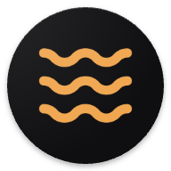

<p align="center">
  
</p>

<h1 align="center">Resurface</h1>

<p align="center">
  <strong>An ally for waking up from autopilot on social media.</strong><br/>
  A native Android app + a custom BLE haptic wristband that notice passive scrolling<br/>
  and hand the moment of choice back to the user — without blocking, judging, or reading screen content.
</p>

<p align="center">
  
  
  
  
  
  
</p>

<p align="center">
  <em>Master of Information Technology capstone (Applied Project) — Asia Pacific International College, Sydney · Graded High Distinction.</em><br/>
  <em>Designed and built end-to-end by one engineer: product, Android app, firmware and PCB.</em>
</p>

---

<!-- 📸 Add the screenshots from the presentation to docs/media/ and they will render here -->
<p align="center">
  
</p>

## Table of contents

- [The problem](#the-problem)
- [How it works](#how-it-works)
- [Key engineering decisions](#key-engineering-decisions)
- [Architecture](#architecture)
- [AI in the flow](#ai-in-the-flow)
- [The wristband (hardware)](#the-wristband-hardware)
- [Tech stack](#tech-stack)
- [Spec-driven development](#spec-driven-development)
- [Testing](#testing)
- [Getting started](#getting-started)
- [Project documentation](#project-documentation)
- [Status & roadmap](#status--roadmap)

---

## The problem

"Zombie mode" is real, and no one chooses to enter it: long, fast, passive short-video sessions that begin without intention and end with a sense of wasted time.

Blockers and punitive apps tend to fail — they produce guilt and resistance, and are quickly uninstalled. Resurface takes a different stance:

| Principle | What it means in practice |
|---|---|
| **Ally, not a blocker** | Never blocks, never hides the close button. *Continue* is always one tap and never penalised. |
| **Behaviour, not content** | Reads *how* you scroll, never *what* you see. Screen-content retrieval is switched off. |
| **Only claims what it measures** | The app knows how much time passed. It never infers mental state ("you were on autopilot"). |
| **Everything stays local** | Only numbers are stored, on the device. No account, no backend. |
| **Silence by default** | The app is designed to be forgotten most of the time. Ignored alerts buy more silence. |

> *"You've been on Instagram for 22 minutes. Is this still what you want to be doing?"*

## How it works

Two nodes talking over Bluetooth:

```
┌──────────────────────┐        ┌───────────────────────────┐        BLE        ┌──────────────────┐
│     Android app      │        │      Gentle reminder      │  ──────────────►  │  Haptic wristband │
│ observes scrolling   │ ─────► │ personalised notification │   haptic command  │ taps the wrist —  │
│ signals in monitored │ episode│ + Continue / Pause /      │                   │ no screen needed  │
│ apps (IG & TikTok)   │detected│   See my time             │                   │                   │
└──────────────────────┘        └───────────────────────────┘                   └──────────────────┘
```

**Behavioural detection — signals only, never content:**

- **Session & time** — reads the live `UsageStatsManager` event stream (queried fresh ~every second, never the aggregated summaries) and turns foreground / background / screen-off events into *episodes* through a pure, deterministic state machine. A single counter spans both apps.
- **Scrolling behaviour** — an `AccessibilityService` scoped to Instagram and TikTok listens to just two event types (`TYPE_VIEW_SCROLLED`, `TYPE_WINDOW_STATE_CHANGED`) with content retrieval disabled.
- **From raw scrolls to meaning** — vertical `ViewPager` movements are grouped whenever a pause exceeds 0.5 s; each group counts as one video watched, and a swipe that reverses mid-burst is flagged as a *started-and-returned* gesture.
- **What is stored** — videos per surface (Reels vs Feed), returned gestures and session duration. Numbers only, kept on the device.

The two sources are independent, so one can fail without taking the other down.

## Key engineering decisions

**1. Validate the signal before building.** Before writing product code, I ran instrumented detection rounds on a real device (Samsung A53, One UI 8, Android 16) against Instagram and TikTok, logging raw accessibility events ([`app/docs/logs/`](app/docs/logs/)). Findings, from [`REELS.md`](app/docs/REELS.md):

| Signal | Result |
|---|---|
| Video counting | 9 real swipes → **9 counted, 0 false positives** |
| Returned gestures | Detected in **~8%** of swipes, with a distinct signature |
| Time via accessibility | ❌ Watching and having left both emit **0 events/s** (measured up to 158.7 s) |

**2. The data changed the architecture.** Because accessibility events cannot tell "watching" from "gone", **time** and **behaviour** were split into two sources: `UsageStatsManager` owns the clock, accessibility owns the behaviour metrics.

**3. No fragile state.** The open episode is always *derivable* from UsageStats, so it is never persisted — Room only stores closed episodes. Permission state is read live from the OS, never cached.

**4. Phased delivery.** Validate the signal → ship the app → treat the wristband as v2 behind a seam (`AlertHaptics`), so the notification path never depends on Bluetooth.

## Architecture

Feature-sliced MVVM with unidirectional data flow and a **pure Kotlin domain layer** (no `android.*` imports — testable on the JVM).

```
┌──────────────────────────────────────────────────────────────────┐
│ UI        Stateless Composables ── ViewModel (immutable UiState)   │
│                                         │                          │
│ DOMAIN    EpisodeEngine · AlertPolicy · SwipeDetector ·            │  ← pure Kotlin
│           ScheduleGate · MessageGuard · TemplateComposer ·         │
│           InsightsAggregator                                       │
│                                         │                          │
│ DATA      Repositories ── Room · DataStore · UsageStatsReader ·    │  ← platform APIs
│                           AlarmScheduler · Notifier · BLE          │     behind interfaces
└──────────────────────────────────────────────────────────────────┘
                     dependencies only point downwards
```

```
com.resurface.resurface/
├─ domain/        pure logic: episode engine, alert policy, swipe detection, message guard, insights
├─ data/          usage · behavior · episode (Room) · config/profile (DataStore) · generation · notification · wristband
├─ ble/           GATT client, scanner, connection state machine/reducer, haptic commands
├─ service/       foreground MonitorService, AlertEvaluator, alarm & boot receivers
├─ permission/    live permission checks
├─ di/            Hilt modules (dispatchers injected, never hard-coded)
└─ ui/            Compose screens: onboarding, home dashboard, settings hub, wristband pairing, schedule, profile
```

Engineering rules (from [`ENGENHARIA.md`](app/docs/ENGENHARIA.md)) include: platform APIs behind interfaces, single source of truth with immutable types, injected coroutine dispatchers, theme tokens only (no raw colours), and **every piece of logic ships with a test**.

## AI in the flow

- **Onboarding builds a profile** — routine, hobbies/goals and preferred tone (*Direct*, *Gentle*, *Playful*).
- **Personalised messages** — an LLM writes the reminder in the user's tone, anchored in their own goals (*"you mentioned wanting to run more, and the evening looks good"*) instead of *"you've used it too much"*.
- **Nano-ready by design** — the target model is **Gemini Nano** (on-device, Private Compute Core). The reference device has no AICore, so `CloudMessageGenerator` uses **Gemini Flash** as a faithful proxy behind the `MessageGenerator` interface. Swapping cloud ↔ on-device is a single DI binding.
- **Guardrails** — `MessageGuard` rejects any generated text that claims a mental state or turns into a guilt trip, falling back to hand-curated templates (`TemplateComposer`).
- **Never blocks the moment** — the next message is pre-generated and cached; network errors, empty output or a missing API key silently fall back to templates.
- **A clear boundary** — AI does **not** detect "zombie mode". Detection is signal-based and heuristic; AI only shapes the conversation.

## The wristband (hardware)

A screenless channel: a gentle tap on the wrist nudges without pulling attention back to the phone.

<!-- 📸 Add the hardware photos from the presentation to docs/media/ -->
<p align="center">
  
</p>

- **Hardware evolution** — from an **ESP32-S3 + DRV2605L** haptic driver to a **Seeed XIAO nRF52840** with a **discrete MOSFET driver**: smaller, native BLE, and better suited to the wrist.
- **Full cycle** — schematic → breadboard prototype → PCB layout → **fabricated PCB** with coin vibration motor and battery.
- **App side** (`ble/`) — GATT client, scanner, Bluetooth readiness/permissions, a connection state machine (`WristbandStateReducer`), remembered-device auto-reconnect (no continuous scan), and a configurable-intensity haptic command fired with every alert (fire-and-forget; a silent no-op if disconnected).

## Tech stack

| Area | Technologies |
|---|---|
| Language & UI | Kotlin 2.2, Jetpack Compose, Material 3 (adaptive navigation suite), light & dark themes |
| Architecture | MVVM, UDF, feature-slice packages, pure domain layer |
| DI & async | Hilt, Kotlin Coroutines & Flow, injected dispatchers |
| Persistence | Room (closed episodes, alert outcomes), DataStore (config, profile, wristband prefs) |
| Platform | `UsageStatsManager`, `AccessibilityService`, foreground service, `AlarmManager`, WorkManager, notifications with actions, edge-to-edge, predictive back |
| Connectivity | Bluetooth Low Energy (GATT) |
| AI | Gemini (Flash via REST as a proxy for on-device Nano), OkHttp, kotlinx-serialization |
| Testing | JUnit, kotlinx-coroutines-test, Turbine |
| Hardware | Seeed XIAO nRF52840, MOSFET haptic driver, custom PCB (earlier prototype: ESP32-S3 + DRV2605L) |
| Target | `compileSdk 36` · `targetSdk 36` · `minSdk 36` (Android 16) |

## Spec-driven development

The app was built with **[OpenSpec](openspec/)** and AI coding agents (Claude Code). Every feature went through *propose → design → tasks → apply → archive*:

- **17 archived changes** — e.g. [`episode-core`](openspec/changes/archive/2026-08-09-episode-core/), [`accessibility-capture`](openspec/changes/archive/2026-08-09-accessibility-capture/), [`tone-message`](openspec/changes/archive/2026-08-09-tone-message/), [`wristband-haptics`](openspec/changes/archive/2026-08-09-wristband-haptics/)
- **23 living capability specs** in [`openspec/specs/`](openspec/specs/) — from `episode-tracking` and `alert-policy` to `message-composition` and `wristband-link`

Each change records *why*, *what changes* and *impact* before any code is written, which kept a solo, multi-disciplinary project (app + firmware + hardware) coherent.

## Testing

- Every class with logic ships with a unit test: domain engine, policies, guards, mappers, ViewModels and repositories (UI composables are intentionally excluded).
- The pure domain layer runs on the JVM, with no device or emulator.
- Flows are tested with Turbine; coroutines with injected test dispatchers.

```bash
./gradlew testDebugUnitTest
```

## Getting started

> Resurface is a personal / research tool distributed via sideload — it is not published on the Play Store, which is why it can rely on the Accessibility API with a `specialUse` foreground service.

1. Requirements: Android Studio (AGP 9.x), an Android 16 device (the Gradle daemon toolchain, JDK 25, is auto-provisioned).
2. Copy [`local.properties.example`](local.properties.example) into `local.properties` and (optionally) add your key:
   ```properties
   GEMINI_API_KEY=your_key_here   # without it the app runs fully on hand-written templates
   ```
3. Build and install:
   ```bash
   ./gradlew installDebug
   ```
4. Follow onboarding to grant Usage Access, the Accessibility service and notifications, set your tone and active schedule — and optionally pair the wristband from **Settings → Wristband**.

## Project documentation

The design thinking behind every decision is documented (in Portuguese) in [`app/docs/`](app/docs/):

| Doc | Content |
|---|---|
| [`PRODUTO.md`](app/docs/PRODUTO.md) | Product: principles, scope, decisions log (D1–D25), risks |
| [`ENGENHARIA.md`](app/docs/ENGENHARIA.md) | Engineering guide: golden rules, architecture, patterns, platform APIs |
| [`NEGOCIO.md`](app/docs/NEGOCIO.md) | Why & for whom: hypotheses and success metrics |
| [`REELS.md`](app/docs/REELS.md) · [`TIKTOK.md`](app/docs/TIKTOK.md) | Detection test rounds on Instagram and TikTok, with conclusions |
| [`GAPS.md`](app/docs/GAPS.md) | Platform validation performed on the device |
| [`logs/`](app/docs/logs/) | Raw accessibility logs from the test rounds |

## Status & roadmap

- ✅ **App** — complete: detection, episodes, personalised alerts, dashboard (time per day/hour, episodes, insights), onboarding, schedule, settings.
- ✅ **Data collection** — complete on Instagram and TikTok; the behavioural signal is recoverable on both.
- 🔧 **Wristband** — essentially complete, with the PCB fabricated.
- 🔜 Next: on-device Gemini Nano on AICore-capable hardware, YouTube Shorts, comparing interruption channels (screen vs wrist).

---

<p align="center">
  Built by <a href="https://github.com/felipeassis97">Felipe Assis</a> · Sydney, Australia
</p>
